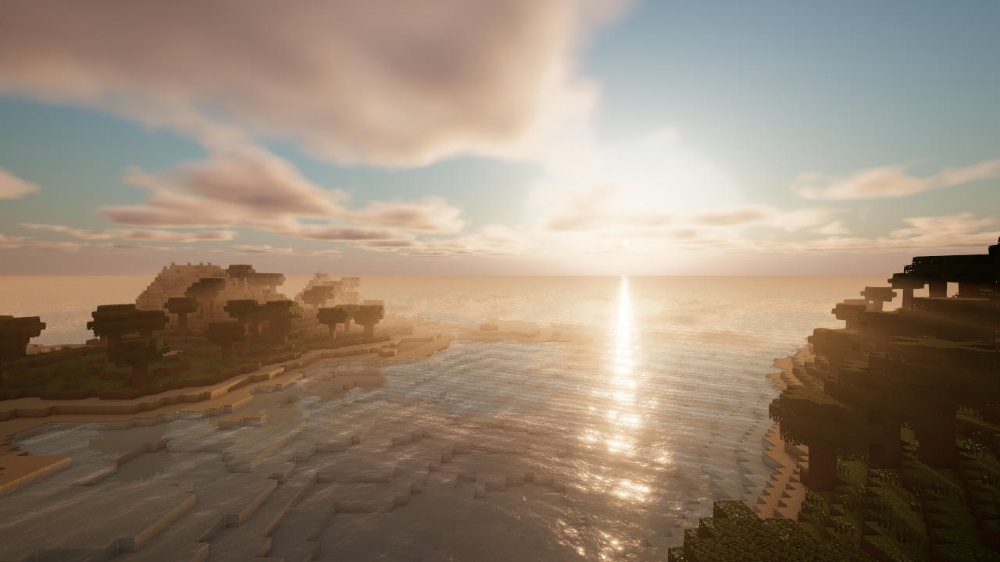
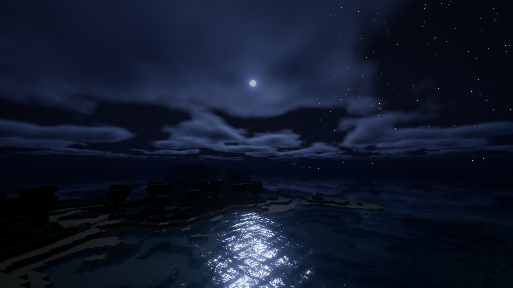
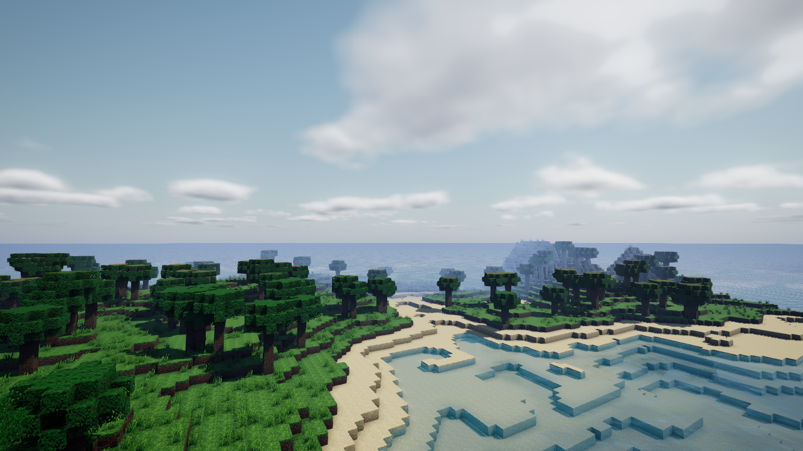

# grokbot-minecraft-clone

> Made with **Grok Bot** in roughly 25 minutes.

A browser voxel sandbox (Minecraft-style) built with Three.js, with "shader-pack" style visuals: a physically based Rayleigh/Mie sky, raymarched volumetric clouds, water with planar reflections, Fresnel, animated waves, depth tint and shore foam, soft shadows that follow the player, GTAO, god rays, bloom, ACES tone mapping and SMAA. Terrain is generated from simplex noise and loaded in chunks, and all textures are drawn in code. There are no build steps or external dependencies, because Three.js r160 is included in the repo.





## Run
```bash
python3 -m http.server 8000
# open http://localhost:8000
```
ES modules don't load over `file://`, so you need a local web server. The site is fully static and works on GitHub Pages as is.

URL options: `?t=0.012` sets the time of day (0–1), `?q=low` starts in low quality, and `?shot&cam=x,y,z,yaw,pitch` gives a HUD-less still camera.

## Controls
| Key | Action |
|---|---|
| Click | Capture mouse |
| WASD / Mouse | Move / look |
| Space | Jump / swim up |
| Shift | Sprint |
| Left / Right click | Break / place block |
| 1–9, wheel | Select hotbar block |
| T | Fast-forward time (×40) |
| **Q** | Toggle High/Low quality (AO, reflections, cloud steps, shadow res, view distance) |

## Screenshots
`shots.py` (Playwright + Chrome) regenerates the images in `shots/`.
